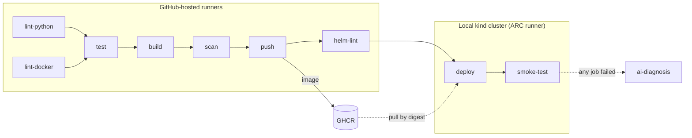

# client-ip-service

A small web service that returns the client's public IP address, with a CI
pipeline that lints, tests, builds, scans, pushes and deploys it to Kubernetes
with Helm, and asks a language model to diagnose any failure.

- [Run locally](#run-locally)
- [How CI works](#how-ci-works)
- [Where the image is published](#where-the-image-is-published)
- [Image scan and SBOM](#image-scan-and-sbom)
- [AI failure diagnosis](#ai-failure-diagnosis)
- [Secrets](#secrets)
- [Design decisions](#design-decisions)

## Run locally

On a kind cluster. Requires Docker, kind, kubectl, Helm, and a free Docker Hub
account for the base images.

```bash
cluster/setup.sh                       # kind, Gateway API, Traefik, namespace staging
docker login dhi.io
docker build -t client-ip-service:local .
kind load docker-image client-ip-service:local --name client-ip
helm upgrade --install client-ip-service charts/client-ip-service \
  --namespace staging --values charts/client-ip-service/values-staging.yaml \
  --set image.repository=client-ip-service --set image.tag=local \
  --set image.pullPolicy=Never --set-json 'imagePullSecrets=[]' --wait
curl http://localhost/                 # {"ip":"172.19.0.1"}: the Docker network, not your public IP
curl http://localhost/health           # {"status":"ok"}
```

## How CI works

`.github/workflows/ci.yml` runs on every push to `main` and on every pull
request. Most jobs run on GitHub-hosted runners. `deploy` and `smoke-test` run
on a self-hosted runner inside the kind cluster, so the cluster is never
exposed to the internet
([ADR-0001](docs/decisions/0001-hybrid-ci.md),
[ADR-0004](docs/decisions/0004-local-runner-actions-runner-controller-arc.md)).



| Job | What it does |
|---|---|
| `lint-python` | ruff |
| `lint-docker` | hadolint |
| `test` | Unit tests; any failure fails the pipeline. Results in the run summary |
| `build` | Multi-stage build, once; the image is handed to the next jobs as a file |
| `scan` | Trivy on that exact image (see [below](#image-scan-and-sbom)) |
| `push` | Pushes the scanned image to GHCR, tagged with the commit SHA |
| `helm-lint` | `helm lint --strict`, with the default and the staging values |
| `deploy` | `helm upgrade --install` to the `staging` namespace, by image digest; rolls back on failure |
| `smoke-test` | pytest against the deployment: endpoints, a forged `X-Forwarded-For` is ignored, the app is unreachable without the gateway |
| `ai-diagnosis` | Only when a job failed (see [below](#ai-failure-diagnosis)) |

**Notifications** come from GitHub itself: a status check on every commit and
pull request, a `staging` deployment record on the repository page, a run
summary (test results, scan, pushed image, deployment), and the AI diagnosis as
a pull request comment on failure.

Pull requests from forks get no secrets, so they cannot push or deploy. To
run the whole pipeline against your own cluster, see
[Deploy through CI](docs/deploy-through-ci.md).

## Where the image is published

```
ghcr.io/reutyadid/client-ip-service:<full commit SHA>
```

GitHub Container Registry, private; the cluster pulls it with a read-only token
([ADR-0009](docs/decisions/0009-private-image-pull-token.md)). `deploy` uses
the digest that `push` produced, so staging runs exactly the image that was
scanned.

## Image scan and SBOM

- Trivy scans the image after the build and before the push. It **fails the
  pipeline** on CRITICAL and HIGH findings that have a fix, so a vulnerable
  image never reaches the registry. Justified exceptions go in `.trivyignore`,
  with a reason.
- Every run saves a **CycloneDX SBOM** and a SARIF report as the `scan-reports`
  artifact, and a findings table in the run summary. On a public repository,
  the SARIF report also appears under Security → Code scanning.
- The Trivy action is pinned to a full commit SHA: its tags were compromised in
  March 2026.

## AI failure diagnosis

When a job fails, the last job sends the failed jobs' logs to a language model
(`openai/gpt-oss-120b` on Groq) and posts the likely cause and a fix in the run
summary and as a pull request comment. Example:
[pull request #1](https://github.com/reutyadid/client-ip-service/pull/1) and its
[failed run](https://github.com/reutyadid/client-ip-service/actions/runs/43870297368)
([ADR-0003](docs/decisions/0003-ai-failure-diagnosis.md),
[ADR-0011](docs/decisions/0011-language-model-provider-groq.md)).

## Secrets

No secret is in the chart or in git. The app itself needs none.

| Secret | Where it lives | Used by |
|---|---|---|
| `DOCKERHUB_TOKEN` (and variable `DOCKERHUB_USERNAME`) | GitHub Actions secret: a read-only Docker Hub token | `build`, to pull the base images |
| `GHCR_PULL_TOKEN` | GitHub Actions secret: a classic token with only `read:packages` | `deploy`, which turns it into the Kubernetes Secret `staging/ghcr-pull` for pulling the image |
| `AI_API_KEY` (and optional variables `AI_API_BASE_URL`, `AI_MODEL`) | GitHub Actions secret: a [Groq](https://console.groq.com/keys) API key | `ai-diagnosis`; without it, failures get a plain notice |
| `github-app` | Kubernetes Secret in `arc-runners`, created by hand | The ARC runner, to register with GitHub (command in `cluster/arc/runner-scale-set-values.yaml`) |

To add a secret to the app later, create a Kubernetes Secret outside the chart
(by hand, or with Sealed Secrets or External Secrets) and reference it from the
Deployment; never put the value in `values.yaml`.

## Design decisions

The significant decisions, with their context and the alternatives that were
considered, are in [docs/decisions](docs/decisions/README.md). Problems hit
along the way are in [docs/troubleshooting.md](docs/troubleshooting.md).
