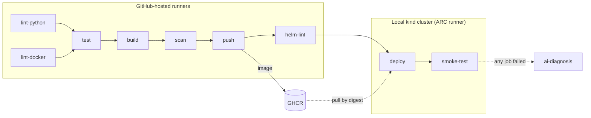

# client-ip-service

A small web service that returns the client's public IP address, with a CI
pipeline that lints, tests, builds, scans, pushes and deploys it to Kubernetes
with Helm, and asks a language model to diagnose any failure.

- [Run locally](#run-locally)
- [How CI works](#how-ci-works)
- [Deploy through CI in your own fork](#deploy-through-ci-in-your-own-fork)
- [Where the image is published](#where-the-image-is-published)
- [Image scan and SBOM](#image-scan-and-sbom)
- [AI failure diagnosis](#ai-failure-diagnosis)
- [Secrets](#secrets)
- [Design decisions](#design-decisions)

## Run locally

Tested with Docker 29.9, kind 0.33, kubectl 1.37, Helm 4.3 and uv 0.13 on
WSL2.

### 1. The app on its own

Requires [uv](https://docs.astral.sh/uv/).

```bash
uv sync
cp .env.example .env
uv run --env-file .env uvicorn --factory app.main:app_from_env --no-proxy-headers --reload
```

```bash
curl http://localhost:8000/        # {"ip":"127.0.0.1"}
curl http://localhost:8000/health  # {"status":"ok"}
curl http://localhost:8000/ready   # {"status":"ready"}
```

Unit tests:

```bash
uv run pytest
```

### 2. The container image

The base images come from Docker Hardened Images, which needs a free Docker
Hub account ([ADR-0007](docs/decisions/0007-base-image-docker-hardened-images.md)).

```bash
docker login dhi.io
docker build -t client-ip-service:local .
docker run --rm -p 8000:8000 \
  -e FORWARDED_ALLOW_IPS=127.0.0.1 -e DOCS_ENABLED=false \
  client-ip-service:local
```

### 3. On Kubernetes (kind)

Requires Docker, kind, kubectl and Helm. `cluster/setup.sh` creates a kind
cluster, installs the Gateway API CRDs and Traefik, and creates the `staging`
namespace. It is safe to re-run.

```bash
cluster/setup.sh
```

This is all a local run needs. The CI runner is installed separately by
`cluster/setup-arc.sh`, only to deploy through CI (see
[Deploy through CI in your own fork](#deploy-through-ci-in-your-own-fork)).

Load the image built in step 2 into the cluster and deploy it with the chart:

```bash
kind load docker-image client-ip-service:local --name client-ip

helm upgrade --install client-ip-service charts/client-ip-service \
  --namespace staging \
  --values charts/client-ip-service/values-staging.yaml \
  --set image.repository=client-ip-service \
  --set image.tag=local \
  --set image.pullPolicy=Never \
  --set-json 'imagePullSecrets=[]' \
  --wait
```

Traefik listens on `localhost:80`, on this machine only
([ADR-0010](docs/decisions/0010-cluster-exposure-nodeport-localhost-only.md)):

```bash
kubectl -n staging get pods
curl http://localhost/        # e.g. {"ip":"172.19.0.1"}
curl http://localhost/health
```

On kind, `/` returns the Docker network's gateway address, not your public
IP: the request never leaves the machine.

## How CI works

`.github/workflows/ci.yml` runs on every push to `main` and on every pull
request. Most jobs run on GitHub-hosted runners. `deploy` and `smoke-test` run
on a self-hosted runner inside the kind cluster, so the cluster is never
exposed to the internet
([ADR-0001](docs/decisions/0001-hybrid-ci.md),
[ADR-0004](docs/decisions/0004-local-runner-actions-runner-controller-arc.md)).



| Job | What it does |
|---|---|
| `lint-python` | ruff |
| `lint-docker` | hadolint |
| `test` | Unit tests; any failure fails the pipeline. Results in the run summary |
| `build` | Multi-stage build, once; the image is handed to the next jobs as a file |
| `scan` | Trivy on that exact image (see [below](#image-scan-and-sbom)) |
| `push` | Pushes the scanned image to GHCR, tagged with the commit SHA |
| `helm-lint` | `helm lint --strict`, with the default and the staging values |
| `deploy` | `helm upgrade --install` to the `staging` namespace, by image digest; rolls back on failure |
| `smoke-test` | pytest against the deployment: endpoints, a forged `X-Forwarded-For` is ignored, the app is unreachable without the gateway |
| `ai-diagnosis` | Only when a job failed (see [below](#ai-failure-diagnosis)) |

**Notifications** come from GitHub itself: a status check on every commit and
pull request, a `staging` deployment record on the repository page, a run
summary (test results, scan, pushed image, deployment), and the AI diagnosis as
a pull request comment on failure.

Pull requests from forks get no secrets, so they cannot push or deploy.

## Deploy through CI in your own fork

CI deploys to the cluster where its runner is registered, and uses the
repository's own secrets. To have CI build, scan, push and deploy to **your**
cluster, use your own copy of the repository. Your GitHub user name and the fork's
name must be lowercase, as GHCR requires.

**1. Fork the repository** and enable workflows in its **Actions** tab (GitHub
disables them on forks).

**2. Create the cluster** (as in [Run locally](#3-on-kubernetes-kind)):

```bash
cluster/setup.sh
```

**3. Register a runner for your fork.** Create a GitHub App under
**Settings → Developer settings → GitHub Apps**, with the repository
permissions **Administration: Read and write** and **Metadata: Read-only**.
Generate a private key, install the app on your fork only, and note the App ID
and the installation ID (the number at the end of the installation page's URL).
Then:

```bash
kubectl create namespace arc-runners
kubectl -n arc-runners create secret generic github-app   --from-literal=github_app_id=<APP_ID>   --from-literal=github_app_installation_id=<INSTALLATION_ID>   --from-file=github_app_private_key=<path/to/key.pem>
```

Point the runner at your fork: in `cluster/arc/runner-scale-set-values.yaml`,
set `githubConfigUrl: https://github.com/<you>/client-ip-service`. Then:

```bash
cluster/setup-arc.sh
```

**4. Add the secrets and variables** under **Settings → Secrets and variables
→ Actions** (see [Secrets](#secrets)):

| Name | Kind | Value |
|---|---|---|
| `DOCKERHUB_USERNAME` | Variable | Your Docker Hub user, to pull the base images |
| `DOCKERHUB_TOKEN` | Secret | A read-only Docker Hub access token |
| `GHCR_PULL_TOKEN` | Secret | A classic GitHub token with only `read:packages`, for the cluster to pull your image |
| `AI_API_KEY` | Secret | A [Groq](https://console.groq.com/keys) API key. Optional: without it, failures get a plain notice |

**5. Push to `main`.** The pipeline pushes the image to
`ghcr.io/<you>/client-ip-service` and deploys it to your `staging` namespace.
Follow it in the **Actions** tab, then:

```bash
kubectl -n staging get pods
curl http://localhost/
```

## Where the image is published

GitHub Container Registry:

```
ghcr.io/reutyadid/client-ip-service:<full commit SHA>
```

The name comes from the repository: CI builds it as
`ghcr.io/${{ github.repository }}` (`IMAGE_NAME` in `ci.yml`) and passes it to
Helm, so a fork publishes to `ghcr.io/<you>/client-ip-service` with no change.
The `image.repository` in `values.yaml` is only the default for a manual
`helm install`; in a fork, set it to your image there or with `--set`.

The package is private; the cluster pulls it with a read-only token
([ADR-0009](docs/decisions/0009-private-image-pull-token.md)). `deploy` uses the
digest that `push` produced, so staging runs exactly the bytes that were
scanned.

## Image scan and SBOM

- Trivy scans the image after the build and before the push. It **fails the
  pipeline** on CRITICAL and HIGH findings that have a fix, so a vulnerable
  image never reaches the registry. Justified exceptions go in `.trivyignore`,
  with a reason.
- Every run saves a **CycloneDX SBOM** and a SARIF report as the `scan-reports`
  artifact, and a findings table in the run summary. On a public repository,
  the SARIF report also appears under Security → Code scanning.
- The Trivy action is pinned to a full commit SHA: its tags were compromised in
  March 2026.

## AI failure diagnosis

When a job fails, the last job sends the failed jobs' logs to a language model
(`openai/gpt-oss-120b` on Groq) and posts the likely cause and a fix in the run
summary and as a pull request comment. Example:
[pull request #1](https://github.com/reutyadid/client-ip-service/pull/1) and its
[failed run](https://github.com/reutyadid/client-ip-service/actions/runs/43772178192)
([ADR-0003](docs/decisions/0003-ai-failure-diagnosis.md),
[ADR-0011](docs/decisions/0011-language-model-provider-groq.md)).

## Secrets

No secret is in the chart or in git. The app itself needs none.

| Secret | Where it lives | Used by |
|---|---|---|
| `DOCKERHUB_TOKEN` (and variable `DOCKERHUB_USERNAME`) | GitHub Actions secret | `build`, to pull the base images |
| `GHCR_PULL_TOKEN` | GitHub Actions secret | `deploy`, which turns it into the Kubernetes Secret `staging/ghcr-pull` for pulling the image |
| `AI_API_KEY` (and variables `AI_API_BASE_URL`, `AI_MODEL`) | GitHub Actions secret | `ai-diagnosis` |
| `github-app` | Kubernetes Secret in `arc-runners`, created by hand | The ARC runner, to register with GitHub (command in `cluster/arc/runner-scale-set-values.yaml`) |

To add a secret to the app later, create a Kubernetes Secret outside the chart
(by hand, or with Sealed Secrets or External Secrets) and reference it from the
Deployment; never put the value in `values.yaml`.

## Design decisions

The significant decisions, with their context and the alternatives that were
considered, are in [docs/decisions](docs/decisions/README.md). Problems hit
along the way are in [docs/troubleshooting.md](docs/troubleshooting.md).
